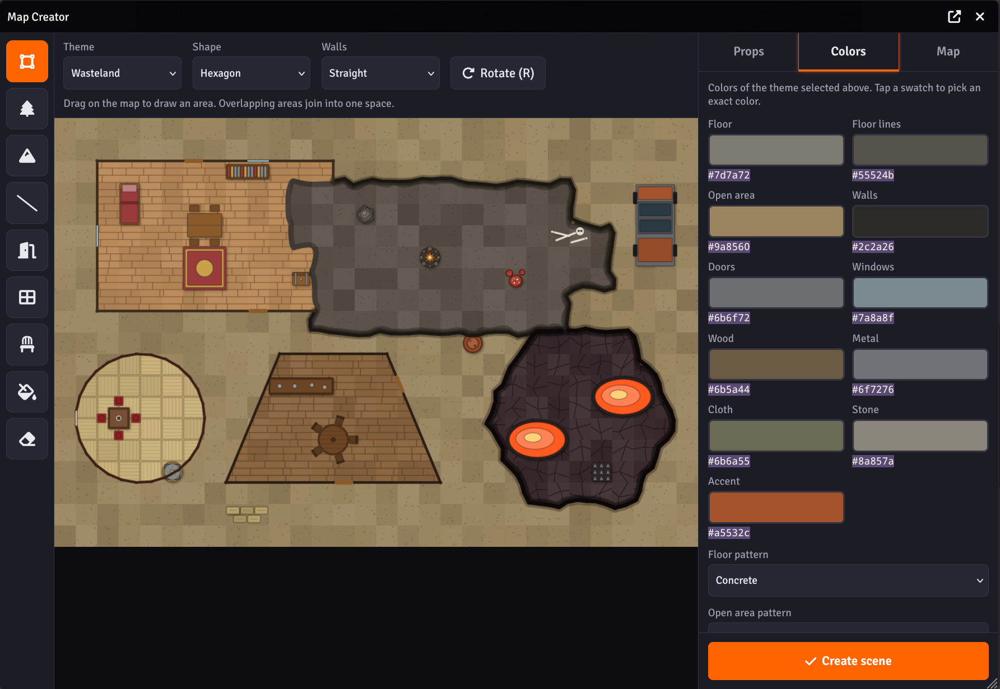
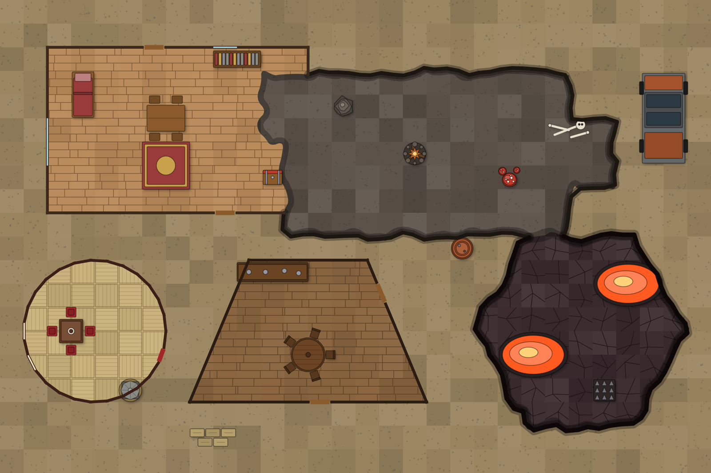
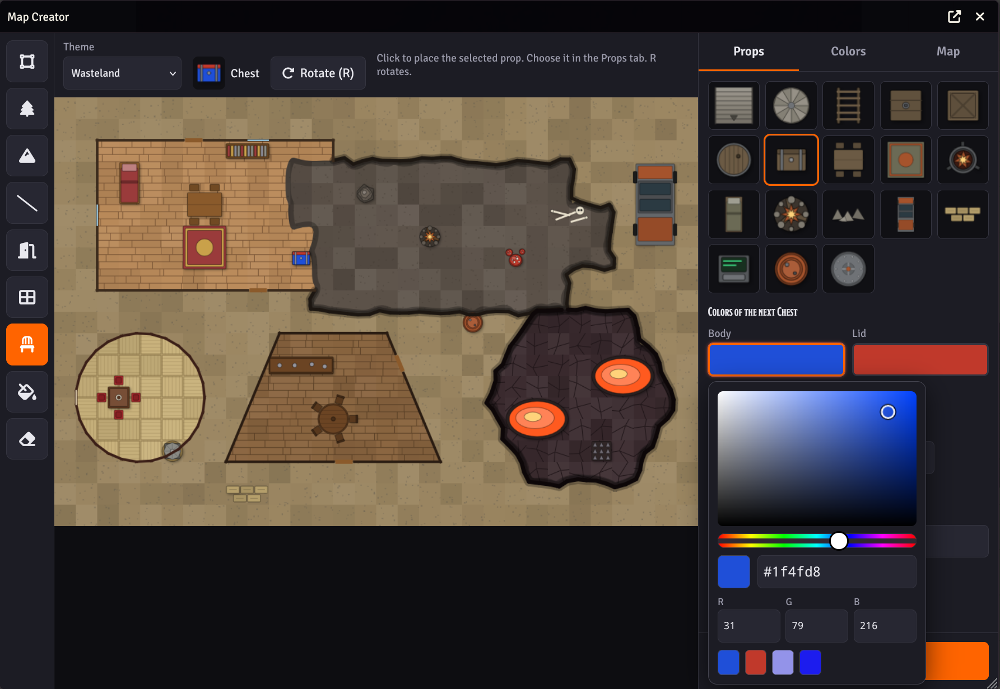
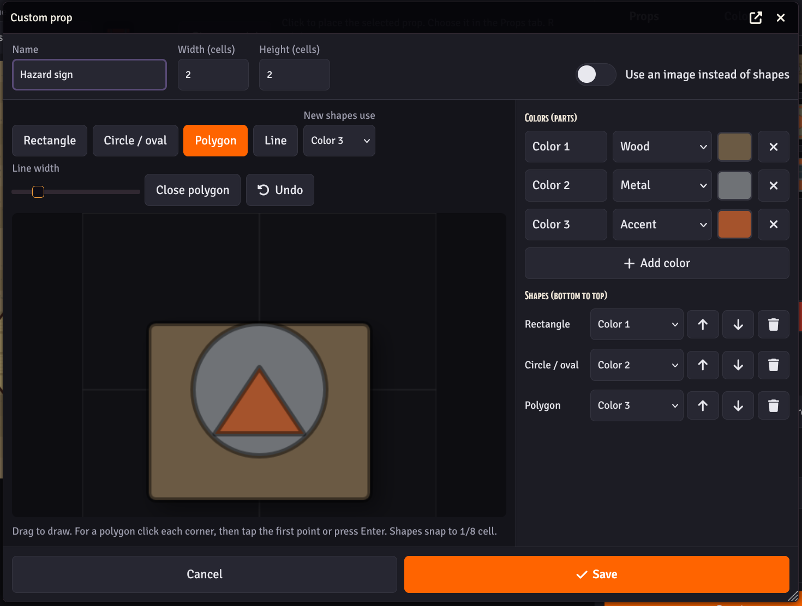

# Map Creator

Draw a simple top-down map inside Foundry VTT and turn it into a Scene with walls in one click. System agnostic, GM only, Foundry v13.



## Features

- **Areas of any shape**: rectangles, circles and ovals, trapezoids, triangles, hexagons, octagons, and cave areas painted with a brush. Straight or irregular (cavern style) walls.
- **One theme per area**: mix a house, a cave, a tower and a street in the same map. Themes: Dungeon, Cave, House, Tavern, Wasteland, Oriental, Infernal.
- **Joined spaces**: areas that overlap become one space, so overlapping a house and a cave makes the passage. Areas that touch keep one wall, and you can put a door on it.
- **Exact colors**: every color of every theme can be set with a picker (color square, hex or RGB), and floor patterns can be swapped freely.
- **Detailed props with recolorable parts**: about 40 props including stairs, ladders and trapdoors. Each part of a prop has its own color.
- **Custom props**: draw your own from shapes with named color parts, or use an image. Saved in the world.
- **Doors, windows, free wall lines, open areas** (floor without walls) and **auto furnish**.
- **Live preview**, then **Create scene**: the map is saved as a PNG and the Scene is created with walls, doors and windows set up.



## Use

1. Open the Scenes tab and click **Map Creator**.
2. Pick a theme and a tool in the left toolbar, then draw. The bar above the map shows the options of the current tool.
3. Use the right panel: **Props** (pick props and recolor their parts), **Colors** (palette of the theme), **Map** (name, size, seed).
4. Click **Create scene**. The PNG goes to `worlds/<world>/map-creator/` and the Scene to a "Map Creator" folder.



### Props and custom props

Pick the colors of a prop before placing it, or click a placed prop with **Apply theme** to edit it. **Save as new prop** keeps a recolored copy under a name you choose. **New custom prop** opens an editor with rectangles, ovals, polygons and lines. Custom props, saved theme palettes and **Save as new theme** copies are stored in the world.



## Limits

Overlapping areas always merge. Doors and windows only go on straight walls. Irregular walls next to another area can leave small gaps. Stairs are only drawn, not linked to other scenes. Image props cannot be recolored. Maps are up to 80x80 cells.

## Install

In Foundry, open **Add-on Modules**, click **Install Module** and paste this manifest URL:

```
https://github.com/GabrielDiasMoraes/foundry-map-creator/releases/latest/download/module.json
```

## Development

```
node --test tests/
```

## License

MIT
